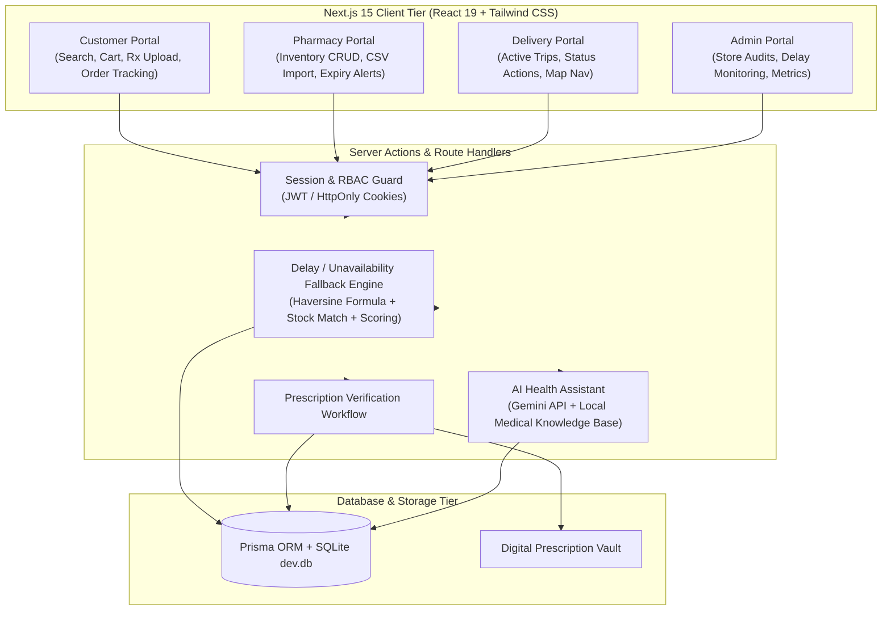

# MediReach – Medicines, Closer to You
### Hyperlocal Medicine Ordering Platform with Automated Delay & Stockout Fallback

MediReach connects patients in **Yelahanka, Bengaluru** with verified local medical stores for rapid medicine ordering and delivery. When an order faces store delays or a selected pharmacy runs out of stock, MediReach's **Delay & Unavailability Fallback Engine** automatically surfaces nearby alternative pharmacies on an interactive map with live stock, distances, and ETAs, allowing 1-click order rerouting.

---

## 1. System Architecture



---

## 2. All 9 Objectives & Concrete Implementations

| # | Objective | Concrete Feature Implementation |
| :--- | :--- | :--- |
| **1** | **Online medicine ordering & delivery** | Search, cart, address/phone inputs, fee breakdown, checkout, live order tracking with stepper pipeline. |
| **2** | **Real-time medicine availability** | Status badges (`In Stock`, `Low Stock`, `Out of Stock`) calculated across 8 Yelahanka stores with unexpired batch quantities. |
| **3** | **Fallback engine for delay/unavailability** | Standalone service module (`src/services/fallbackEngine.ts`) with unit tests; Haversine 5 km geo-radius, multi-factor ranking, Leaflet map, and 1-click switch. |
| **4** | **Digital prescription handling** | Image/PDF upload at checkout, mandatory Rx flag enforcement, pharmacist review queue, approval/rejection with reason. |
| **5** | **AI-powered chatbot** | Server-side Gemini API + medical heuristic fallback with medical disclaimers, symptom triage refusal, and platform help. |
| **6** | **Pharmacy inventory management** | Full CRUD for batches (mfg date, expiry date, MRP, sale price, batch number) + bulk CSV import. |
| **7** | **Expiry-date monitoring** | Dashboard alert tabs for items expiring in `< 30 days`, `< 60 days`, `< 90 days`, and auto-flagging of expired items hidden from customers. |
| **8** | **Smart pharmacy ranking** | Weighted scoring algorithm: Stock Match (40%), Road Distance (30%), Delivery ETA (15%), Store Rating (15%). |
| **9** | **Centralized ecosystem** | 4 role-based portals: Customers, Pharmacy Owners, Delivery Partners (Riders), and Platform Admins. |

---

## 3. Quickstart & Setup (One-Command Execution)

### Prerequisites
- Node.js v18+ or v20+
- npm v9+

### Commands
```bash
# 1. Install dependencies
npm install

# 2. Sync database schema
npx prisma db push

# 3. Seed database with 8 Yelahanka pharmacies, ~50 medicines & pre-configured demo orders
npm run db:seed

# 4. Run unit tests (8 tests verify Fallback Engine logic)
npm test

# 5. Start the production build or development server
npm run build && npm start
# or for local development:
# npm run dev
```

The application will be live at: **`http://localhost:3000`**

---

## 4. Environment Variables (`.env`)

```ini
DATABASE_URL="file:./dev.db"
JWT_SECRET="medireach_jwt_super_secret_session_key_2026_secure"
NEXT_PUBLIC_APP_URL="http://localhost:3000"

# Optional: Add Google Gemini API Key for live AI responses (falls back to local knowledge base if empty)
GEMINI_API_KEY=""

# Configurable fallback engine parameters
FALLBACK_SEARCH_RADIUS_KM="5.0"
ORDER_DELAY_THRESHOLD_MINUTES="10"
```

---

## 5. Demo Credentials & 1-Click Persona Switcher

The application includes a **Demo Role Switcher** at the top of every page. You can switch between roles in 1 click, or sign in manually with these credentials:

| Persona | Email | Password | Role | Description |
| :--- | :--- | :--- | :--- | :--- |
| **Rahul Sharma** | `customer@medireach.in` | `Password123!` | `CUSTOMER` | Customer located in Yelahanka New Town |
| **Dr. Ramesh Kumar** | `apollo@medireach.in` | `Password123!` | `PHARMACY_OWNER` | Owner of Apollo Pharmacy – Yelahanka New Town |
| **Suresh Gowda** | `medplus@medireach.in` | `Password123!` | `PHARMACY_OWNER` | Owner of MedPlus Pharmacy – Old Town |
| **Kiran Nayak** | `delivery@medireach.in` | `Password123!` | `DELIVERY_PARTNER` | Delivery Partner (Rider) |
| **Administrator** | `admin@medireach.in` | `Password123!` | `ADMIN` | Platform Admin |

---

## 6. End-to-End Demo Walkthrough Script

### Scenario 1: The Critical Delay Fallback Engine in Action
1. Open **`http://localhost:3000/orders/cmw6torby00olrejf3rjxkqso`** (or click **"View Delayed Order Fallback"** from the top landing page banner).
2. Observe the banner: **"FALLBACK ENGINE ACTIVATED – Running Late? These nearby pharmacies have your medicines in stock right now."**
3. Notice:
   - The interactive **Leaflet map** showing your location pin (Blue), Apollo Pharmacy (Red/Delayed), and nearby alternative stores (Green).
   - Ranked alternative pharmacies (e.g. *Pradhan Mantri Jan Aushadhi Kendra*, *MedPlus*, *Trust Chemists*) with distance, ETA, and 100% stock match.
4. Click **"Switch Order to this Store"** on any of the alternative stores.
5. Watch the order seamlessly transfer, update the fulfilling store, reset the delay state, and calculate a fresh ETA!

### Scenario 2: Out-of-Stock Detection (Trigger A)
1. Go to `/medicines` and search for **"Azithromycin 500mg"**.
2. Click on the medicine to view details.
3. Observe the live stock table: **Apollo Pharmacy has 0 units** (Out of stock), while **MedPlus** (1.1 km) and **Aster** (2.3 km) have valid stock.
4. Click **"Select & Add"** from MedPlus and complete checkout.

### Scenario 3: Prescription Upload & Pharmacist Verification Queue
1. Add **"Augmentin 625 Duo"** (Rx required) to the cart and proceed to `/cart`.
2. Notice the yellow mandatory Rx badge. Click **"Attach Sample Prescription (Dr. Anand Rx)"** or upload a document.
3. Click **"Confirm & Place Order"**.
4. In the top bar, switch persona to **"Dr. Ramesh Kumar (Apollo Owner)"**.
5. Navigate to **Store Dashboard** (`/pharmacy/dashboard`) and click the **"Prescription Verification Queue"** tab.
6. Inspect the doctor prescription details and click **"Approve Prescription & Advance Order"**.

### Scenario 4: Pharmacy Inventory CRUD, Expiry Alerts & CSV Import
1. In the **Pharmacy Dashboard**, observe the 5 KPI metric cards:
   - `< 30 Days Expiry` (Red alert)
   - `< 60 Days Expiry` (Amber alert)
   - `Auto-Flagged Expired` (Hidden from customers)
   - `Low Stock (≤10)`
2. Click **"Add Batch"** to add a new medicine batch with custom expiry date.
3. Click **"CSV Import"** to bulk import batches from CSV text with automatic validation.

### Scenario 5: Delivery Partner Dispatch
1. In the top bar, switch persona to **"Kiran (Rider)"** and visit `/delivery/dashboard`.
2. View active delivery assignments with pickup store directions and customer drop location.
3. Click **"Confirm Medicines Picked Up from Store"** and **"Confirm Doorstep Delivery to Customer"**.

### Scenario 6: AI Health Assistant
1. Visit `/ai-assistant`.
2. Ask: *"What is Dolo 650 used for?"* or click one of the suggested query chips.
3. Notice the pharmacological breakdown with mandatory safety disclaimers.
4. Test emergency symptoms (*"I have severe chest pain"*); notice the system strictly refuses medical diagnosis and triggers emergency triage (112 / 108).

---

## 7. Known Limitations & Future Roadmap

1. **Real Payment Gateway**: Currently simulates Cash on Delivery / UPI upon arrival. Production deployment will integrate Razorpay / PhonePe Indian payment gateways with webhook idempotency.
2. **SMS / WhatsApp Gateway**: Currently triggers in-app notification toasts and order status history logs. Production will connect Twilio or Gupshup for transactional SMS/WhatsApp order alerts in Kannada and English.
3. **Live GPS Rider Tracking**: Currently computes real-time distance and transit speeds via Haversine and urban speed profiles (18 km/h). Future integration will stream live rider coordinates via WebSockets / Supabase Realtime.
4. **Machine Learning Demand Prediction**: Future enhancements will analyze seasonal flu and prescription patterns in Bengaluru urban clusters to suggest automated inventory replenishment before stockouts occur.

